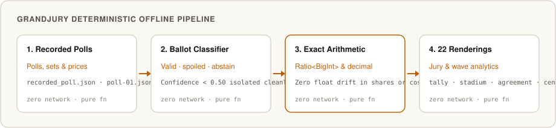

  <picture>
    <source media="(prefers-color-scheme: dark)" srcset="media/grandjury-architecture-dark.svg">
    <source media="(prefers-color-scheme: light)" srcset="media/grandjury-architecture-light.svg">
    
  </picture>

# Grandjury Architecture

Grandjury aggregates discrete-choice answers from panels of LLM seats ("juries") across single polls, repeated waves, and multi-set evaluation campaigns. It separates raw API envelope normalization (`seats`, `makers`) from pure, exact-arithmetic consensus readings.

## Four-Stage Pipeline

1. **Ballot ingestion and seat normalization (`polls`, `seats`, `makers`, `json`).** Raw model envelopes (`answers.decision` and `choices[0].message.content`) are normalized into version 1 `Poll` records, automatically converting sub-`0.5` confidence answers into explicit abstentions (`GJ-5`) and validating UTF-8 poll JSON files in a single defect-accumulating pass (`GJ-1`, `GJ-49`).
2. **Disjoint ballot classification and fencing (`polls`, `record`).** Every juror response is classified into one of three mutually exclusive buckets (`valid`, `abstained`, or `spoiled`), while shared line-break guards (`FIX-GJ-14` through `FIX-GJ-18`) fence questions, offered answers, juror names, model identifiers, chosen answers, and reasons before any reading renders.
3. **Exact rational tallying and flat response pricing (`polls`, `agreement`, `pynum`, `pydecimal`).** Vote shares (`count / valid`), lowest-terms fractions, half-up rounded percentages, pluralities, margins, and flat per-response decimal dollar totals (`cost`) are computed with `BigInt`, `BigRational`, and exact decimal arithmetic.
4. **Twenty-two consensus, dissent, and wave readings (`cli` and reading modules).** Pure functions render single-poll tallies, `#` bar-chart stadiums with walls of reasons, flat response costs, per-model agreement, two-wave movement (`held`, `moved`, `not counted`), and seventeen multi-set readings across labelled poll directories.

## Module Map

| Module | Responsibility |
| --- | --- |
| `rust/src/cli.rs` | Twenty-two command dispatcher, `<label> <dir>` pair slicing (`slice::as_chunks`), and exit routing |
| `rust/src/polls.rs` | Poll and price-table validators plus `tally`, `stadium` (`#` bars + `wall of reasons`), and `cost` renderers |
| `rust/src/record.rs` | Shared response predicates (`is_valid`) and `check_poll_text` line-break guards (`FIX-GJ-14`..`FIX-GJ-18`) |
| `rust/src/seats.rs`, `makers.rs` | Raw route envelope parsers (`confidence < 0.5` abstention rule) and offline `pilot` / `full` / `wave` makers |
| `rust/src/agreement.rs`, `compare.rs` | Per-model plurality/share breakdown (`agreement`) and two-wave stability comparator (`compare`) |
| `rust/src/census.rs`, `ledger.rs`, `dissent.rs`, `swing.rs`, `minority.rs`, `bench.rs`, `pool.rs`, `aggregate.rs`, `canvass.rs`, `roll.rs`, `muster.rs`, `margin.rs`, `accord.rs`, `standing.rs`, `answers.rs`, `pairs.rs`, `shares.rs` | Seventeen multi-set analytical readings covering consensus, dissenters, swing courses, model-jury turnouts, accord, and cross-set shares |
| `rust/src/json.rs`, `pydecimal.rs`, `pynum.rs`, `pytext.rs`, `pyunicode.rs`, `scan.rs` | Depth-bounded JSON parser, exact decimal/rational arithmetic, surrogate-safe text fencing, and codepoint scanner |

## Determinism and Safety Invariants

- **Descriptive neutrality.** Every reading reports exact counts, lowest-terms fractions, pluralities, margins, and structural labels (`held`, `moved`, `swung`, `in accord`, `divided`) without ever grading a model "right" or "wrong".
- **Strict plurality rule (`FIX-GJ-8`).** A plurality stands only when at least one valid vote exists and a single offered answer strictly leads every other offered answer. Ties at the top report `none` rather than breaking arbitrarily by list order.
- **Exact decimal per-response spend (`GJ-4`, `FIX-GJ-2`).** Pricing tables store flat per-response rates as decimal strings (`"0.000052"`) summed once per recorded response in exact base-10 arithmetic.
