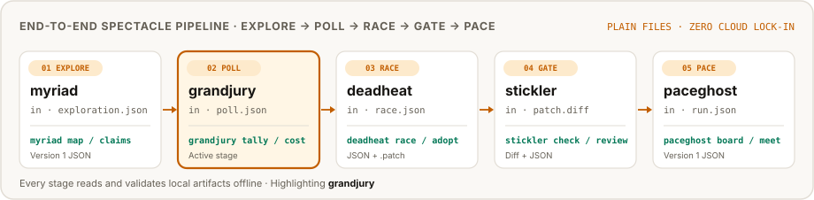

<p align="center">
  <picture>
    <source media="(prefers-color-scheme: dark)" srcset="media/pipeline-flow-dark.svg">
    <source media="(prefers-color-scheme: light)" srcset="media/pipeline-flow-light.svg">
    
  </picture>
</p>

# Grandjury Pipeline Cookbook and CI Automation

This cookbook walks through a complete five-tool **Spectacle Line** engineering loop over plain local files, followed by drop-in GitHub Actions and Unix manual page recipes for `grandjury`.

## Five-Stage Closed-Loop Multi-Agent Recipe

Every artifact below is minimal valid version 1 JSON or unified diff text, paired with exact output produced by the compiled release binaries.

### Stage 1 - Map Open Design Forks with `myriad`

Before polling models or writing code, record open sub-questions, settled findings (`taken`), and ruled-out dead ends (`abandoned`) in `retry-map.json`.

```json
{
  "question": "How should the worker queue bound stale retry storms",
  "branches": [
    {
      "id": "b1",
      "parent": null,
      "prompt": "Cap retry queue depth per tenant",
      "state": "taken",
      "finding": "Bounds memory under burst load",
      "claim": "scout-a"
    },
    {
      "id": "b2",
      "parent": null,
      "prompt": "Drop retries silently after 5 seconds",
      "state": "abandoned",
      "reason": "Violates delivery guarantee",
      "claim": "scout-b"
    },
    {
      "id": "b3",
      "parent": "b1",
      "prompt": "Choose token-bucket vs sliding-window eviction",
      "state": "open",
      "claim": "scout-a"
    }
  ]
}
```

```sh
myriad map retry-map.json
```

```text
question, How should the worker queue bound stale retry storms
b1 (taken) Cap retry queue depth per tenant
  claimed by scout-a
  finding, Bounds memory under burst load
  b3 (open) Choose token-bucket vs sliding-window eviction
    claimed by scout-a
b2 (abandoned) Drop retries silently after 5 seconds
  claimed by scout-b
  reason, Violates delivery guarantee
branches 3, open 1, taken 1, abandoned 1
```

### Stage 2 - Poll a Multi-Model Jury on the Open Fork with `grandjury`

Once branch `b3` narrows to finite architectural options, poll a multi-model jury in `eviction-poll.json` (`< 0.5` confidence seats carry `"abstained": true`).

```json
{
  "question": "Which bounded eviction strategy should guard the tenant retry queue?",
  "answers": [
    "token-bucket",
    "sliding-window",
    "unbounded-fifo"
  ],
  "responses": [
    {
      "juror": "jev-1",
      "model": "jev-1.13",
      "answer": "token-bucket",
      "reason": "Constant O(1) state per tenant with burst allowance"
    },
    {
      "juror": "jev-2",
      "model": "jev-1.13",
      "answer": "token-bucket",
      "reason": "Predictable refill math without timestamp ring buffers"
    },
    {
      "juror": "chat-1",
      "model": "gpt-6-luna",
      "answer": "token-bucket",
      "reason": "Matches downstream rate-limiter semantics cleanly"
    },
    {
      "juror": "chat-2",
      "model": "gpt-6-luna",
      "answer": "sliding-window",
      "reason": "Smoother boundary behavior",
      "abstained": true
    }
  ]
}
```

```sh
grandjury tally eviction-poll.json
```

```text
question, Which bounded eviction strategy should guard the tenant retry queue?
responses, 4
valid, 3
spoiled, 0
abstained, 1
token-bucket, 3, 100.0%
sliding-window, 0, 0.0%
unbounded-fifo, 0, 0.0%
```

### Stage 3 - Race Two Competing Implementations with `deadheat`

Run or score two competing implementations of the winning `token-bucket` design in `eviction-race.json`.

```json
{
  "version": 1,
  "task": "implement tenant token-bucket retry guard",
  "attempts": [
    {
      "model": "prime-1",
      "environment": "lane-a",
      "result": "green",
      "finished_at": 42.5,
      "tokens": 18400,
      "patch": "--- /dev/null\n+++ b/retry_guard.py\n@@ -0,0 +1,4 @@\n+class TokenBucket:\n+    def __init__(self, rate: int, burst: int) -> None:\n+        self.rate = rate\n+        self.burst = burst\n"
    },
    {
      "model": "shadow-1",
      "environment": "lane-b",
      "result": "green",
      "finished_at": 51.0,
      "tokens": 22100,
      "patch": "--- /dev/null\n+++ b/retry_guard.py\n@@ -0,0 +1,4 @@\n+class SlidingWindow:\n+    def __init__(self, limit: int, window: int) -> None:\n+        self.limit = limit\n+        self.window = window\n"
    }
  ]
}
```

```sh
deadheat race eviction-race.json
```

```text
race implement tenant token-bucket retry guard
prime-1 in lane-a, green in 42.5 seconds, 18400 tokens
shadow-1 in lane-b, green in 51 seconds, 22100 tokens
verdict, prime-1 wins
funeral for implement tenant token-bucket retry guard
winner prime-1 in lane-a went green in 42.5 seconds
loser shadow-1 in lane-b went green in 51 seconds
margin 8.5 seconds between the two finishes
```

### Stage 4 - Gate the Winning Python Diff with `stickler`

Verify the winning patch (`winner.diff`) against `stickler`'s six deterministic Python smell shapes before review or merge.

```diff
--- /dev/null
+++ b/retry_guard.py
@@ -0,0 +1,4 @@
+class TokenBucket:
+    def __init__(self, rate: int, burst: int) -> None:
+        self.rate = rate
+        self.burst = burst
```

```sh
stickler check winner.diff
```

```text
Review of winner.diff
Verdict, accepted
Objections, 0
```

### Stage 5 - Project Window Token Burn with `paceghost`

Compare `prime-1`'s checkpoint token burn against `standing-ghost.json` and verify that projected full-window consumption stays comfortably inside the `1,000,000`-token window budget using exact `BigRational` projection math.

```json
{
  "task": "implement tenant token-bucket retry guard",
  "window_seconds": 1800,
  "runner": "baseline-ghost",
  "recorded_at": "2026-02-10",
  "total_seconds": 54,
  "usage": 21200,
  "splits": [
    {
      "phase": "plan",
      "elapsed_seconds": 16
    },
    {
      "phase": "implement-and-test",
      "elapsed_seconds": 54
    }
  ]
}
```

```json
{
  "task": "implement tenant token-bucket retry guard",
  "window_seconds": 1800,
  "runner": "prime-1",
  "recorded_at": "2026-02-14",
  "total_seconds": 42.5,
  "usage": 18400,
  "budget": 1000000,
  "model": "prime-1",
  "splits": [
    {
      "phase": "plan",
      "elapsed_seconds": 12.5
    },
    {
      "phase": "implement-and-test",
      "elapsed_seconds": 42.5
    }
  ],
  "reads": [
    {
      "elapsed_seconds": 0,
      "usage": 0
    },
    {
      "elapsed_seconds": 15,
      "usage": 6200
    },
    {
      "elapsed_seconds": 42.5,
      "usage": 18400
    }
  ]
}
```

```sh
paceghost board prime-run.json standing-ghost.json
```

```text
read 0 at 0 seconds, usage 0, projects no figure
read 1 at 15 seconds, usage 6200, projection 744000, past the ghost usage, inside the budget
read 2 at 42.5 seconds, usage 18400, projection 779294.117647, past the ghost usage, inside the budget
finish, actual usage 18400 against a last projection of 779294.117647, inside the ghost usage, inside the budget, the board missed it
```

## Reusable GitHub Action (`action.yml`)

`grandjury` ships a root composite `action.yml` so any workflow can install `grandjury` onto `PATH` and run a check or reading in two lines of YAML.

```yaml
- uses: david-engelmann/grandjury@v0.1.0
  with:
    command: tally
    target-path: examples/recorded_poll.json
```

Leave `command` empty if you want to install `grandjury` once and invoke multiple commands in subsequent workflow steps.

## Offline Manual Page (`man/grandjury.1`)

Inspect the bundled `man(1)` reference page locally without network access or browser tabs.

```sh
man ./man/grandjury.1
```
