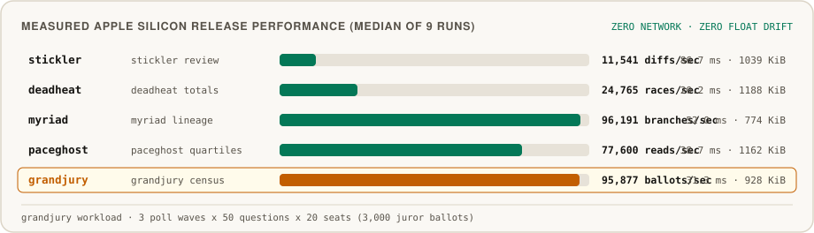

  <picture>
    <source media="(prefers-color-scheme: dark)" srcset="media/benchmark-chart-dark.svg">
    <source media="(prefers-color-scheme: light)" srcset="media/benchmark-chart-light.svg">
    
  </picture>

# Grandjury Performance and Footprint

`grandjury` is engineered as a standalone native Rust binary with zero runtime daemons, zero heap-heavy ORM layers, and linear single-pass loaders.

## Measured Release Benchmarks

Measured on Apple Silicon (`cargo build --release --locked`, median wall-clock duration across nine consecutive runs over synthetic local inputs, including process spawn, file read, full schema validation, computation, and `stdout` flush).

| Metric | Measured Figure | Notes |
| --- | --- | --- |
| Release binary size | `928.0 KiB` (`950,288` bytes) | Standalone native executable (`--bin grandjury`) |
| Benchmark command | `grandjury census` | Full end-to-end CLI invocation |
| Synthetic workload | 3 poll waves x 50 questions x 20 seats (3,000 juror ballots) | Validated whole before rendering |
| Median wall-clock time | `31.29 ms` | Median of 9 cold-process runs |
| Sustained throughput | `95,877 ballots/sec` | Includes JSON parsing and line-break fencing |

## Spectacle Line Release Comparison

| Binary | Release Size | Benchmark Command | Synthetic Workload | Median Latency | Throughput |
| --- | --- | --- | --- | --- | --- |
| `stickler` | `1039.4 KiB` | `stickler review` | 1,000 Python diffs (9,000 lines, 1,000 flags) | `86.65 ms` | `11,541 diffs/sec` |
| `deadheat` | `1188.4 KiB` | `deadheat totals` | 100 series (500 two-lane races, 1,000 attempts) | `20.19 ms` | `24,765 races/sec` |
| `myriad` | `774.3 KiB` | `myriad lineage` | 10-step lineage x 25 entries (5,000 branches) | `51.98 ms` | `96,191 branches/sec` |
| `paceghost` | `1161.8 KiB` | `paceghost quartiles` | 10-day meet x 12 runners (3,000 timed reads) | `38.66 ms` | `77,600 reads/sec` |
| `grandjury` | `928.0 KiB` | `grandjury census` | 3 waves x 50 polls x 20 seats (3,000 ballots) | `31.29 ms` | `95,877 ballots/sec` |

## Resource and Memory Guarantees

- **Bounded parser stack.** Every JSON loader runs an iterative stack machine capped at `9997` open containers (`PORT-3`), preventing stack-overflow crashes on adversarial nesting.
- **Bounded integer literals.** Integer tokens exceeding `4300` digits are rejected deterministically rather than stalling big-integer allocation.
- **Zero background threads.** Every analytical reading executes single-threaded and deterministically from input bytes to output lines.
